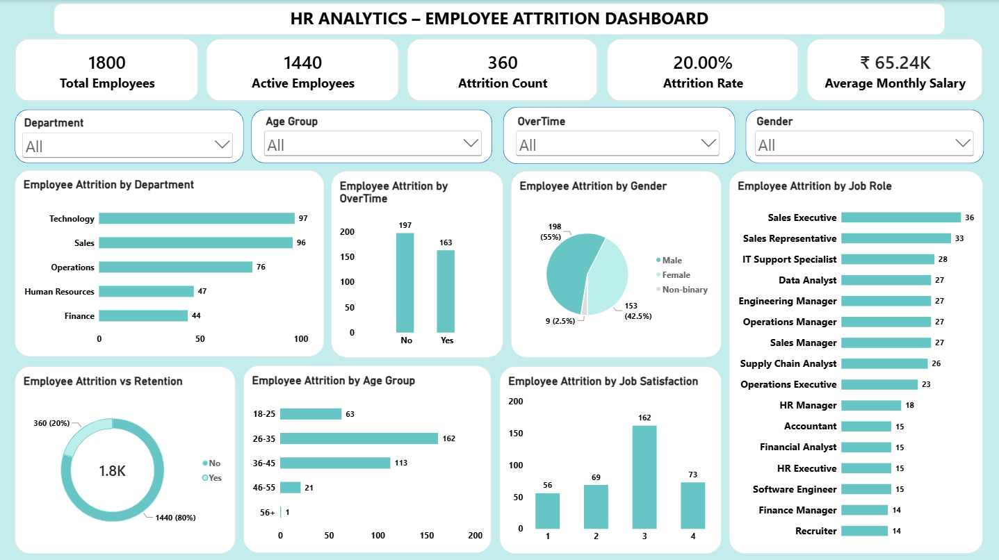

# HR Analytics – Employee Attrition Dashboard

## Project Overview
This project focuses on analyzing employee attrition using Microsoft Power BI. The dashboard provides insights into employee turnover, department-wise attrition, age groups, gender, overtime, and job satisfaction.

The project uses a simulated dataset containing 1,800 employee records.

## Dashboard Preview

## Tools & Technologies
- Microsoft Power BI
- Power Query
- DAX (Data Analysis Expressions)

## Dataset
The dataset contains 1,800 employee records with information such as:
- Employee ID and Age
- Gender and Department
- Job Role
- Monthly Income
- Job Satisfaction
- Overtime
- Attrition Status

**Note:** This is a simulated dataset created for learning and portfolio purposes. It does not contain actual company employee information.

## Key Performance Indicators (KPIs)
- Total Employees: 1,800
- Active Employees: 1,440
- Attrition Count: 360
- Attrition Rate: 20%
- Average Monthly Salary

## Dashboard Features
- Department-wise employee attrition analysis
- Age group-wise attrition analysis
- Attrition by overtime
- Job satisfaction analysis
- Gender-wise attrition analysis
- Active employees vs. attrition donut chart
- Interactive slicers for Department, Age Group, Overtime, and Gender

## Key Insights
- Overall employee attrition rate is 20%.
- The 26–35 age group recorded the highest number of employee exits.
- Technology recorded the highest department-wise attrition count.
- Job satisfaction level 3 recorded the highest number of exits.
- The dashboard helps explore attrition patterns using interactive filters.

## Skills Demonstrated
- Data Cleaning and Transformation
- Data Analysis
- DAX Measures
- KPI Development
- Data Visualization
- Interactive Dashboard Development
- HR Analytics

## Project Files
- `HR_Analytics_Employee_Attrition_Dashboard.pbix` – Power BI dashboard file.
- `PowerBI_HR_Analytics_Attrition_Dataset.csv` – Dataset used in the project.

## How to Use
1. Download or clone this repository.
2. Open the `.pbix` file using Microsoft Power BI Desktop.
3. If prompted, update the Excel data source path.
4. Explore the dashboard using the interactive slicers.

## Author
**Syed Shahzaib Farid**

Aspiring Data Analyst | Power BI | SQL | Advanced Excel

GitHub: [syedshahzaibfarid149](https://github.com/syedshahzaibfarid149)

